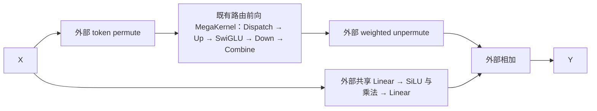
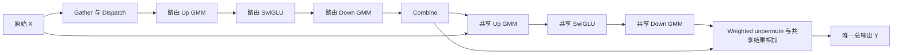
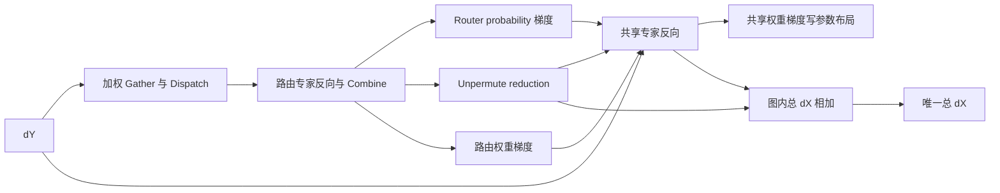
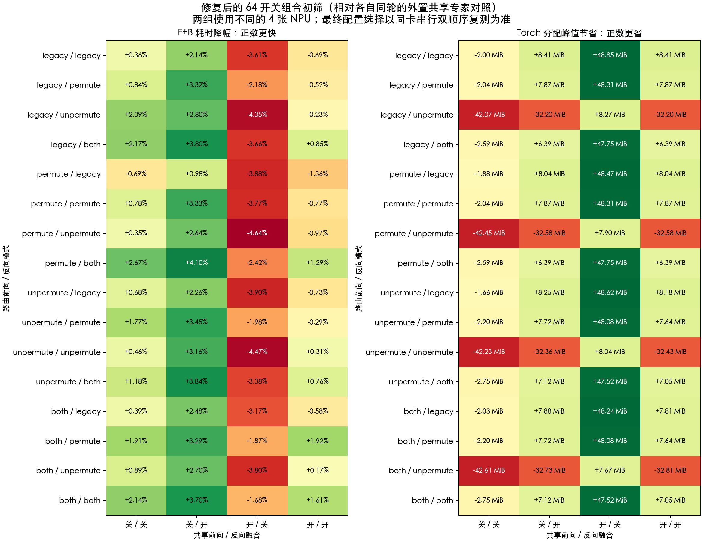

# MegaMoe 全融合边界与缓冲区复用修复评测

日期：2026-11-03。本文对应前后向路由端点及共享专家的完整整合，历史 64 组合结果保留在
[2026-11-02 报告](mega_moe_switch_matrix_results_20261102.md)，不能用历史测量直接替代本次复测。

本次固定形状下，速度与显存折中推荐 `both/both/共享前向关/共享反向开`：
33.245 ms，相对同轮外置共享分支耗时下降 4.49%，Torch 分配峰值 2435.10 MiB。
全融合为 34.238 ms、下降 1.31%，分配峰值比修复前下降 415.97 MiB（14.59%）。
全融合已将两个分支的输出及 dX 相加纳入 kernel；它仍不是全部口径下的最优开关组合。
下文同时列明正式形状的旧有梯度精度差异、小形状执行顺序敏感和零接收 rank 问题，
这些限制使本轮结果不能直接推广为所有训练场景的全局默认值。

## 本次修复与接口

旧实现把共享计算加入同一次 MegaKernel launch，但前向仍在图外做 `routed + shared`，
反向仍在图外做 `dX_routed + dX_shared`。共享反向还错误地使接收区复用检查失败，
并把共享权重梯度写成转置布局后再复制为参数布局。本次分别修复这三处开销。

```python
experts = MegaMoeExperts(
    local_num_tokens=4096, hidden_size=5120, intermediate_size=1792,
    num_experts=32, top_k=8, shared_intermediate_size=1792,
    ep_group=ep_group, fusion_mode="full",
).to(device="npu", dtype=torch.bfloat16)
y = experts(x, topk_ids, topk_weights, tokens_per_expert=counts)
```

`fusion_mode="full"` 等价于两个路由方向都取 `both`、共享前向和共享反向都启用。
它要求正的共享宽度，拒绝冲突的独立开关。省略预设时，原有四项独立设置继续生效；
预设不改变不适用形状的支持范围。公共 forward 返回唯一的总输出，autograd 返回原始输入、
Router probabilities、两组路由专家权重和两组共享专家权重的梯度。

四项开关独立保留：两个路由方向各取 `legacy/permute/unpermute/both`，共享前后向各为布尔值，
合计 `4*4*2*2=64` 种。反向 `permute` 表示 dY 的索引读取与加权并入 Dispatch，
反向 `unpermute` 表示返回原始 token 顺序时的 dX 归约。共享开关关闭仍执行共享专家，不能省略其工作量。

### 外置共享分支对照图



其反向使用外部加权 dY 展开及 dTopK 计算、既有路由反向 MegaKernel、外部 token dX 归约，
并由 autograd 执行共享分支反向及最终 dX 相加。两条分支的实际反向遍历顺序由 autograd 决定。
这个对照已经融合了路由专家主体，不能把本报告的百分比解读为相对完全未融合 MoE 的收益。

### 全融合前向图



共享 Down 直接写入最终输出的 `[T,H]` 缓冲区。归约任务在 UB 中先把路由加权和舍入为 BF16，
再加已舍入的共享输出，最后舍入为 BF16 并原位写回。保留原来分支相加的舍入边界，
不再物化独立的路由总输出或启动图外相加。为计算 Router 梯度保留的专家输出快照仍然存在。

### 全融合反向图



反向保留 unpermute 与路由权重梯度计算的重叠。在它们均完成后，共享反向复用路由
`act_grad` / `swiglu_grad` 临时区中互不相交的切片存放 dactivation、dup、共享 dX 和权重梯度；
容量不足时退回独立分配。共享 gate dX 完成后，由同一次 kernel 内的 128-row Vector 任务完成 dX 相加，
该相加不等待共享 W1/W2 梯度，可与共享 W1 梯度计算重叠；终止事件同时汇合相加和两组共享权重梯度。
总 dX 使用独立 `[T,H]` 存储，直接交给 autograd，不需要图外 clone/add；它不与临时区别名。

共享权重梯度直接写 `[2I_s,H]` 和 `[H,I_s]`，无需转置。若它们位于复用的较大临时区，
先释放其他路由临时引用，再复制为紧凑的返回梯度，避免小梯度将整个大缓冲区保活。
该复制仍有成本，报告不会将其描述成完全零复制。全融合反向不覆盖前向专家输出快照，
保留计算图时也无需克隆该快照。重复反向和多个 pending forward 的反序 backward 均做单独验证。

接收区复用检查仅排除符合既定间接指针表端口约定的共享 SwiGLU-grad。
路由 SwiGLU-grad 的端口、每个专家的完整事件依赖和 Cube 工作队列先读后写顺序仍须通过检查。
未知读取端口、改变的事件触发计数都会关闭复用。典型形状下可消除额外的
`[32768,5120]` BF16 gate dX 分配，即 320 MiB；这不是对总峰值下降的直接承诺。

### 描述符与构建边界

保留现有 native schema 和任务描述符大小。输出描述符使用已有共享指针表地址和槽位；
任务 `extra_value_1` 的 bit 0 继续表示 acquire-only，bit 1 表示前向原位合入共享残差。
反向 reduction 写共享指针表第 11 槽，图内相加复用已有 `TASK_ADD_CUSTOM` 类型；任务数量增加 `T/128`。
没有向最多 4 个输入的任务描述符追加第五个输入。

新 Python 调度必须配套本次重新编译的前后向 vendor。旧二进制不会解码新标志位，
不能混用。诊断端口同步映射到真实的共享输出/dX 缓冲区。

## 性能评测口径

使用现有 MegaMoe 固定形状 benchmark：每个 rank 的 `T=4096,H=5120,I_r=1792,I_s=1792`，
全局路由专家 `E=32`、`K=8`、EP=4、world size=4；设备为 910B3，
每设备 20 Cube / 40 Vector，BF16 输入及权重、FP32 Router probabilities、EIO 路由权重布局。
采用静态 push，初始容量因子 1.5，预留接收容量 49152 行，平衡路由实际接收 32768 行。
不包含 Router 网络、Attention、优化器更新或完整训练 step。
性能迭代只保留一个待反向的 forward，不进行梯度累积；多 pending forward 仅作生命周期正确性验证，
不代表已经测量流水线或 checkpoint 训练的峰值。

路由公式为 `ids[t,k]=(8*t+k+8*rank)%32`，概率为 `[8,7,6,5,4,3,2,1]/36`。
每个源 rank 向每个专家发送 1024 行，每个本地专家接收 4096 行。显式传入准确的
`tokens_per_expert`，不计构建直方图的成本，但计入计数交换、路由元数据准备和容量检查。
输入及上游梯度种子为 `30000+rank`；本次 reference/candidate 的参数都在构造前重置为
`99173+rank`，保证逐值相同。旧版本复测通过独立启动脚本补充相同重置，未修改其算子实现。

对照为同一版本 vendor 下的既有 MegaMoe 路由路径加图外共享分支：
`legacy/legacy/sf0/sb0`。它也已经使用 MegaKernel；相对该对照的收益不是相对普通未融合 MoE 的收益。
另外在保留旧 vendor 的隔离目录测量修复前的全融合、旧最快配置和路由融合配置，
用于区分整合修复收益与历史机器状态变化。

64 组合初筛分为两组，各自使用 0–3 / 4–7，组合内 reference/candidate 顺序执行；
两组同时运行但不共用设备。候选最终复测使用独占的同一组设备，正序、反序分别进行，
不直接按两组的绝对延迟给全局最快结论。每组合启动新进程，排除跨组合的缓存/SHMEM 生命周期。
每 3 秒采样设备进程；出现其他任务的整轮结果废弃并重测。早先遭遇 8 卡外部任务的采样不纳入结果。

每次计时包含 route preparation、前向、反向和相应框架调度；在计时前清空梯度、执行 rank barrier
和设备同步，计时后再次同步。主要指标是逐迭代取所有 rank 最大值后的主机 F+B 中位数；
同时记录 NPU Event 的 rank-max 中位数及全部样本。不能把独立测量的分段 rank-max 相加重构总延迟。
数值回归先于正式性能测量。性能测量不启用 profiler。
初筛每条路径执行 1 次有效性检查、8 次预热和 30 次正式采样；全融合初筛使用 10/50。
候选最终复测的每种执行顺序均为 1 次检查、10 次预热、50 次采样。

Torch 峰值在每个 backend 的首次检查前重置，覆盖首次检查、预热和正式迭代；
参数、输入和初始化缓存等已存活分配计入峰值。
`peak_allocated` 是 allocator 跟踪的峰值，`peak_reserved` 是缓存池峰值，
`peak_device_used_sampled` 是迭代结束后同步采样的物理已用显存，后者不是连续监控的瞬时峰值。
SHMEM 对称堆另行记录，不能将 Torch 分配下降直接等同于同等物理 HBM 下降。

## 性能与显存结果

<!-- BEGIN MEASURED RESULTS -->

四项开关全部 64 组合均有有效测量。内部追踪发现并修复 dX 相加过度等待后，重测了受影响的 16 组合；
另 48 组合的执行图、内存行为及二进制均未改变，保留其有效测量。中间版本结果不混入最终矩阵。
最终候选在设备 4–7 串行执行，正反两种 backend 顺序各采样 50 次。下表 F+B 为合并 100 个 rank-max 样本的中位数；
峰值取两轮较大者，节省量取两轮配对差值较小者，因此采取保守口径。单轮数据、均值、min/max、Event 和所有样本见证据 JSON。

| 配置 | F+B ms | 同轮参考 ms | 耗时降幅 | 分配峰值 MiB | 最少节省 MiB | 缓存池峰值 MiB | HBM 同步采样最大 MiB |
| --- | ---: | ---: | ---: | ---: | ---: | ---: | ---: |
| `fboth_bboth_sf0_sb1` | 33.245 | 34.808 | +4.49% | 2435.10 | +7.12 | 2502 | 4259.75 |
| `fpermute_bboth_sf0_sb1` | 33.408 | 34.738 | +3.83% | 2435.84 | +6.39 | 2534 | 4283.86 |
| `funpermute_bboth_sf0_sb1` | 33.435 | 34.674 | +3.57% | 2435.10 | +7.12 | 2808 | 4566.33 |
| `flegacy_bboth_sf0_sb1` | 33.456 | 34.757 | +3.74% | 2435.84 | +6.39 | 2882 | 4631.70 |
| `fpermute_bpermute_sf0_sb1` | 33.659 | 34.644 | +2.84% | 2434.35 | +7.87 | 2534 | 4284.93 |
| `flegacy_bpermute_sf0_sb1` | 33.775 | 34.746 | +2.79% | 2434.35 | +7.87 | 2882 | 4633.03 |
| `funpermute_bpermute_sf0_sb1` | 33.818 | 34.728 | +2.62% | 2434.51 | +7.72 | 2808 | 4566.40 |
| `fboth_bboth_sf0_sb0` | 34.097 | 34.664 | +1.63% | 2444.98 | -2.75 | 2566 | 4325.52 |
| `fboth_bboth_sf1_sb1` | 34.238 | 34.693 | +1.31% | 2435.18 | +7.05 | 2482 | 4240.03 |
| `fboth_bboth_sf1_sb0` | 35.407 | 34.679 | -2.10% | 2394.70 | +47.52 | 2440 | 4199.75 |
| `fboth_bpermute_sf1_sb0` | 35.561 | 34.742 | -2.36% | 2394.15 | +48.08 | 2440 | 4198.43 |
| `flegacy_blegacy_sf1_sb0` | 36.096 | 34.634 | -4.22% | 2393.38 | +48.85 | 2862 | 4612.91 |

`fX_bY_sfA_sbB` 分别表示路由前向、路由反向、共享前向、共享反向。耗时降幅为正代表更快，
节省为正代表更省；MiB 为 `2**20` 字节。HBM 是迭代后同步采样，不能称作瞬时峰值。

### 固定形状配置建议

- 本轮候选中实测中位数最低为 `fboth_bboth_sf0_sb1`：33.245 ms，相对同轮参考耗时下降 4.49%。领先配置间只有小幅差异，不能据此保证所有批次唯一最快。
- 速度与显存折中优先使用 `both/both/False/True`：33.245 ms，Torch 分配峰值 2435.10 MiB；相对外置参考两种顺序至少节省分配 7.12 MiB、缓存池 368 MiB、HBM 同步采样 397.78 MiB。
- 最低 Torch 分配峰值仍来自 `legacy/legacy/True/False`，但缓存池和 HBM 并不随之最低，且有明显延迟代价。
- 若优先实际设备占用而接受约 2% 的延迟代价，选择 `both/both/True/False` 或复测表中的 `both/permute/True/False`；前者缓存池峰值为 2440 MiB，分配峰值只比绝对最小多约 1.3 MiB。
- `fusion_mode="full"` 的 F+B 为 34.238 ms，耗时相对外置参考下降 1.31%。它保证本次完整整合边界，并不保证比部分融合更快或更省所有口径的显存。
- 没有一个组合同时取得最小延迟、最低 Torch 分配、最低缓存池和最低 HBM 采样值。不修改全局默认值；以上是本次固定形状的显式配置建议。

```python
# Balanced fixed-shape settings; shared expert work remains enabled.
forward_fusion_mode="both"
backward_fusion_mode="both"
forward_shared_expert=False
backward_shared_expert=True
```

### 修复前后同卡复测

| 配置 | 修复前 F+B ms | 修复后 F+B ms | 修复前分配峰值 MiB | 修复后分配峰值 MiB | 峰值降低 MiB |
| --- | ---: | ---: | ---: | ---: | ---: |
| `fboth_bboth_sf1_sb1` | 34.497 | 34.238 | 2851.14 | 2435.18 | 415.97 |
| `fboth_bboth_sf0_sb1` | 33.421 | 33.245 | 2850.92 | 2435.10 | 415.81 |
| `fboth_bboth_sf0_sb0` | 34.196 | 34.097 | 2444.98 | 2444.98 | 0.00 |

全融合分配峰值下降 415.97 MiB（14.59%）。旧最快配置下降 415.81 MiB。
旧新版各自同进程包含相同参考，原始数据保留参考漂移。不能把不足 1% 的跨轮变化全部归因于单项优化；
显存下降则可在相同配置和两种顺序中重复复现。旧报告“最快配置增加约 400 MiB”的问题在本次固定形状下已消除。

### 任务数量

| 配置 | 前向 AIC / AIV | 反向 AIC / AIV |
| --- | ---: | ---: |
| `flegacy_blegacy_sf0_sb0` | 320 / 3073 | 640 / 3073 |
| `fboth_bboth_sf0_sb1` | 320 / 3329 | 720 / 3777 |
| `fboth_bboth_sf1_sb1` | 360 / 3361 | 720 / 3777 |
| `fboth_bboth_sf1_sb0` | 360 / 3361 | 640 / 3713 |

AIV 队列包括终止任务。原有前向 `cfg.task_num` 按约定不计终止任务，反向包含它；
因此不将这两个字段直接混加比较。全融合反向的 32 个 dX 相加任务已计入 AIV 数量。



完整 [CSV 表](benchmarks/mega_moe_full_fusion_20261103.csv) 和 [JSON 证据](benchmarks/mega_moe_full_fusion_20261103.json)
包含所有组合、最终复测、逐迭代样本、任务数量、复用状态、环境和源码/产物哈希。

<!-- END MEASURED RESULTS -->

## 收益与剩余开销的解释

本次修复明确消除错误关闭的接收区复用、共享权重梯度转置和完整融合下的两次图外分支相加，
并将串行共享反向临时值写入已完成的路由临时区。
显存收益取决于这些分配与 FFN 激活、权重梯度、快照的峰值存活区间，不能将被消除的张量大小直接相加。

完整融合仍然需要路由专家前后向的计算、跨 rank Dispatch/Combine、接收区、FFN 激活、
Router 梯度所需快照及最终结果。共享任务当前排在路由工作完成之后，仍有串行调度成本；
共享专家 GMM 也未因合并 launch 而消失。UB 内的路由归约仍要读取各个 Top-K 专家结果，
保持 BF16 舍入边界还需要额外转换。这些成本限制总收益。
仅凭一个外层 custom op 不能证明内部 AIC/AIV 重叠，更不能把理论流量下降当作实测加速。

按两个 SwiGLU 投影的矩阵乘法估算，每 rank 路由及共享分支一次 F+B 仍有
`18*(32768+4096)*5120*1792 ≈ 6.09 TFLOP`。这是运算量估算，不是设备吞吐量测量；
融合没有减少这部分矩阵乘法，也没有消除跨 rank 通信。共享前向单独开启、反向关闭的组合，
反向还会重新执行共享前向以构造 autograd 图，因此更省显存也可能更慢。

主要存储的单张量大小如下，不能直接相加为峰值，因为它们的存活区间不同：

| 存储 | 本次大小 MiB | 本次是否消除 |
| --- | ---: | --- |
| 路由参数 W1/W2 及其梯度 | 各 420 | 保留 |
| 路由接收输入快照、供 Router 梯度使用的专家输出快照 | 各 320 | 保留 |
| 路由 Up / SwiGLU 激活 | 224 / 112 | 保留，反向完成后部分复用 |
| 错误关闭复用导致的额外 gate dX | 320 | 通过调度校验后消除 |
| 共享参数或一组共享权重梯度 | 52.5 | 参数保留；梯度直接写布局，复用时返回前紧凑复制 |
| 单个 `[4096,5120]` 输出或 dX | 40 | 总结果保留，消除额外分支合并结果及相应复制 |

### 追踪证据与性能瓶颈

独立采集的内部 cycle trace 在 4 个 rank 均无丢失记录；下表列出 rank 0 的实际计算任务区间。
区间跨度是同阶段最早 task 开始到最晚 task 结束，可能包含多核调度间隙，不是独立测得的算子耗时，
也不能把重叠阶段相加作为主表的 F+B 延迟。统计排除了 WAIT_DEP 和 TriggerEvent 记录。

| 追踪项 | 修复前跨度 ms | 最终版本跨度 ms | 解释 |
| --- | ---: | ---: | --- |
| 共享前向 Up / SwiGLU / Down | 0.594 / 0.206 / 0.285 | 0.593 / 0.179 / 0.310 | 共享计算仍完整执行 |
| 前向 weighted unpermute | 0.812 | 0.916 | 新版还承担 BF16 共享输出合入及相关读写 |
| 路由反向 unpermute | 0.782 | 0.787 | 与路由 W1 梯度的重叠保留 |
| 共享 gate dX | 0.555 | 0.557 | 计算后即可启动 dX 相加 |
| 共享 W1 梯度 | 0.607 | 0.633 | 与最终 dX 相加并行 |
| 图内 dX 相加 | 图外执行 | 0.485 | 已移出等待 W1 完成后的串行尾部 |

最终 rank 0 的共享 W1 梯度区间为 `78.020–78.652 ms`，dX 相加为 `78.042–78.527 ms`，
时间戳相对诊断窗口起点。两者在该次追踪中重叠；终止任务仍等待两者和 W2 梯度完成。
中间版本把相加放在所有共享权重梯度完成后，约 0.42 ms 完全落在串行尾部；
定位后才进行事件拆分，并重测受影响的 16 个组合。主表仅使用最终调度数据。

`torch_npu.profiler` 的框架记录中，完整融合不再出现 `[4096,5120]` 的图外分支加法，
但仍有长度为 8 的路由元数据 `aten::add`，不能按函数名断言所有 add 都被消除。
仍可看到为保存快照及返回紧凑权重梯度所做的 clone。此次导出的框架 trace 没有可用的
AICore kernel 指标，不用其 CPU 时间代表 device 耗时；上述内部重叠结论仅来自 cycle trace。

性能仍未出现大幅加速的原因是：对照已是 MegaKernel；融合主要消除端点与分配开销，
没有减少约 6.09 TFLOP 的主体矩阵乘法和 SHMEM 通信。共享前向仍与路由主体串行，
完整融合还需要 UB 内 BF16 转换和残差读取。矩阵也显示共享前向融合在这一形状下不如外部路径，
但现有证据不能将差值精确分解为 GMM tiling、Vector 效率或单项调度开销。
下一步若继续扩大收益，应单独比较共享 GMM 的 tiling、逐块残差流水与路由/共享跨分支调度；
这些尚未实施，不将其理论收益计入本次结论。

## 正确性与适用边界

- 主机侧 `tests/ut/core/multicore` 为 295 passed、1696 subtests passed；
  覆盖 64 组合图、事件计数、描述符端口、复用拒绝条件、诊断映射与公共预设检查。
- EP2、`T=128,H=5120,I_r=128,I_s=1792,E=4,K=2` 的 64 组合，在两个 rank 均通过输出及全部六类梯度比较；
  与外置共享分支比较使用原有 `rtol=0.05,atol=0.01`，并记录 max-abs/RMS。不是逐位等价的声明。
- EP4 正式形状，全融合相对修复前原生全融合的输出、dX、两组路由权重梯度及两组共享权重梯度逐位一致。
  Router probability 梯度按 `rtol=0.02,atol=0.002` 检查；保留计算图重复 backward、两个 pending forward 反序 backward 严格逐位比较。
- 相同 native 归档在全新解压目录的正式形状回归通过 4 个 rank，且核对源码和 payload 哈希一致；
  `fresh-payload-final-formal.log` 保留原生对照与生命周期检查结果。该通过结论不包括下述小形状失败用例。
- 正式形状与外置分支比较时，共享 W1 梯度约 29–41 / 18,350,080 个元素未满足原有逐元素阈值，
  最大违规绝对差约 0.0142；全张量 max-abs 为 0.03125，RMS 约 0.00329。修复前原生路径在相同位置出现相同误差，
  本次没有放宽外置比较阈值来宣称通过；用保存的旧原生结果逐位比较证明改动没有新增该误差。
- 额外零接收 rank 用例 `T128,H5120,I128,E4,K2`、全部路由到专家 0/1 时，修复前后原生全融合均在反向发生
  AIV scalar internal-buffer 越界，清理阶段的 SIGSEGV 为后续错误。它不属于本次平衡形状的验收范围，仍是已知限制；
  不据此宣称支持任意零 rank / 任意偏斜生产路由。首个设备异常和对照日志均保留。
- 全新进程仅执行“小随机形状的外置对照 → 全融合”时，重复反向也在修复前后复现同类 AIV 越界；
  而同形状完整 64 组合顺序回归通过。该执行顺序敏感问题尚未定位根因，不能将完整矩阵通过外推为任意调用顺序均可用。
  新旧对照分别保存在 `fresh-payload-test.log`、`numeric-small-cold-old.log`；不是产物哈希不一致导致。

本次不修改全局默认值，仅提供明确的 `fusion_mode="full"` 预设。全局默认选择须考虑以上路由及精度限制，
固定形状推荐按本文矩阵与复测结果选择，不外推为所有形状、动态 token、pull 或 910C 的实测结论。

## 构建与可复现证据

隔离环境为 `hp-megamoe-cann91`：Python 3.11.15、Torch 2.7.1+cpu、torch_npu 2.7.1.post4、
CANN 9.1.0-beta.3；未修改任何已有 Conda 环境。当前仓库通过 source build 交付 native payload，未携带旧格式 prebuild。

```bash
source /home/yjk/Ascend-9.1.0-beta.3/cann/set_env.sh
export PATH=/home/yjk/.conda/envs/hp-megamoe-cann91/bin:$PATH
export CPATH=$ASCEND_HOME_PATH/aarch64-linux/pkg_inc/base${CPATH:+:$CPATH}
bash hyper_parallel/core/multicore/build.sh --soc-list ascend910b --jobs 8
source build/native/payload/hyper_parallel/core/multicore/lib/set_env.bash
```

远端候选目录为 `/home/yjk/workspace/hyper-parallel-megamoe-full-20261103`，旧版本目录为
`/home/yjk/workspace/hyper-parallel-megamoe-20261029`；原始结果位于
`/home/yjk/workspace/results/megamoe-full-20261103`。源码/生成副本及每个 payload 文件的 SHA256 随证据 JSON 保存。
源分支基线为 `e0cdf62c9d66f1f9ec48c6f15df87dcf4ce80a5f`；修复前整合提交为
`b5de3257c556c16ad750d115b3abd29ebc8f8dfe`。旧控制目录处于早先 worktree 提交上，
但已覆盖为修复前整合源码；与该整合提交仅两个图文件的注释/文档字符串不同。
以证据中的源码和二进制逐文件哈希识别实际运行版本，不将 worktree HEAD 当成源码未修改的证明。
交付前已无冲突同步到最新上游 `8abb8e93d17f668117eaf09595acb1cddf1a74c6`，并重新通过
295 项主机测试、1696 个子用例及正式形状 4-rank 数值回归。上游在 Multicore 中仅修改
MegaGate/MegaMhc 的 FP32 参数名称声明，MegaMoe、SHMEM、框架绑定、native 算子及性能脚本未变；
性能表仍明确使用前述评测基线，证据分别记录评测和交付基线。
制品归档 `native-payload-cann91-910b.tar.gz` 保留在结果目录；其 SHA256 为
`6ed06ea6c649909d09c606cfeb28a9e61206d887c59de3269fb471b4d03c2481`。
