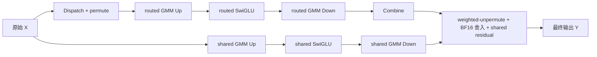

# MegaMoe 共享专家调度优化性能报告（2026-11-04）

固定 benchmark 中，采用“shared Up 提前、shared Down 保持在 routed Down 之后”的队列。
同进程正反顺序复测的完整 F+B 中位耗时由保存点的 **34.412 ms 降至 33.272 ms**，降低 **3.31%**（1.0343 倍加速）。
shared 前向关闭、反向开启的对照为 33.498 ms；本轮全融合的中位耗时低约 0.68%，幅度较小。
**allocated 峰值没有进一步下降**：保存点与新全融合均为 2435.18 MiB。
这些结论限定于下述固定形状，不是模型级训练 step 或重新扫描全部 64 种配置后的全局推荐。

## 保存点、源码与运行环境

保存点为 `c77c9242f757185e3767ea3687ccdbe4cffef4bd`，已保存到 GitHub 的
[`backup/shared-forward-before-schedule`](https://github.com/yjkyjkyjk/hyper-parallel/tree/backup/shared-forward-before-schedule)
及标签 `megamoe-shared-forward-before-schedule`。原功能分支保留保存点；试验和最终候选在
`exp/shared-forward-overlap-20261104`，未创建 PR。
初始调度源码为 `d4597e72`，最终运行源码为 `fe6ee7634d920e62a54cd98744846bffb952cb67`。
最终候选 rank 0 的前后向 runtime 字节串，已与正式复测记录的获胜消融配置逐字节 SHA 核对一致；
另保留全部 4 个 rank 的 runtime SHA 与最终源码独立运行结果。

| 项目 | 配置 |
| --- | --- |
| 平台 | ascend910b-blue，910B3；实际 20 Cube、40 Vector；当前 MegaMoe 使用 20 个 Vector worker |
| 软件 | CANN 9.1.0-beta.3；Python 3.11.15；Torch 2.7.1+cpu；torch_npu 2.7.1.post4 |
| 环境 | `/home/yjk/.conda/envs/hp-megamoe-cann91`；未修改其他 conda 环境 |
| 基线 worktree | `/home/yjk/workspace/hyper-parallel-megamoe-schedule-base-20261104` |
| 消融 worktree | `/home/yjk/workspace/hyper-parallel-megamoe-shared-overlap-20261104` |
| 最终源码 worktree | `/home/yjk/workspace/hyper-parallel-megamoe-shared-final-20261104` |
| 原始结果 | `/home/yjk/workspace/results/megamoe-shared-overlap-20261104` |

本轮只修改 host 图事件与队列，不修改 native 数学原语、ABI、tiling 或张量分配。
上述 worktree 使用同一归档全新解压的 native payload；每个目录的 46 个文件均逐个核对 SHA。
前向输入/输出 arity 仍为 28/6，反向为 32/8。归档 SHA256：
`73f521fb73f42a76f355d721ca2a2a63887e876c9c75195cd7f0c0ec536ec19a`。

## 性能评测口径

- 每 rank 的输入为 BF16 `[4096,5120]`；routed/shared intermediate 均为 1792；32 个 routed experts，top-k=8，EP=4、TP=1、权重 EIO，static push。
- 路由为确定性均衡分配：`id=(8*t+k+8*rank)%32`，概率为 `[8,7,6,5,4,3,2,1]/36`。
  输入 seed 为 `30000+rank`，权重 seed 为 `99173+rank`；共享权重由本地 rank 持有。
- 目标配置前后向 route 均为 `both`，shared 前后向均为 `True`。
  部分融合对照为同样的 route 配置、`shared_forward=False/shared_backward=True`。
  外置参考则为 `legacy/legacy/False/False`，共享分支通过框架 dense linear/SiLU/mul 完成；三者语义工作相同。
- 计时包围**完整 forward + backward**，包括路由准备、框架 launch、最终分支合并、所有梯度和末尾设备同步；不含建层、首次编译、梯度清零、优化器、测试用 rank 同步及计时后的统计归约。
  在进入计时前完成各 rank barrier 与设备同步；一次调用同时记录同步墙钟和 NPU Event。
- 每个采样先对各 rank 耗时取 MAX，再统计这些 rank-max 样本；不把不同阶段或不同 rank 的最大值相加。
- 初筛每种配置 8 次 warmup、30 次采样。正式复测复用已有 benchmark 的 `_benchmark_performance_backend`，
  在同一分布式进程中逐个建立/释放各方案，保持输入与权重 seed 相同；先按列出的顺序，再反转顺序。
  每种配置每个顺序 10 次 warmup、50 次采样，合计 100 个正式样本。表中均值、中位数、范围取合并的 100 样本。
- 表中正式比较使用物理卡 4–7。每 2 秒采集 NPU 进程；发现其他训练进程的轮次整轮作废，保留日志并重新轮询。
  `joint/` 中首次受争用复测不计入结论；采用 `joint-valid/accepted.json` 指向的无争用轮次（48 次占用快照）。
  不同卡组、不同日期的数字不拼接成同一组受控结论。
- 显存统计在每个 backend 建层后重置，涵盖首轮梯度校验、warmup、正式采样及结果整理；不包含建层瞬时峰值。
  Torch allocated/reserved 各自取 rank-max，正式比较表再取两个顺序的最大值；SHMEM 另列，不能简单与 reserved 相加推算物理 HBM。
  NPU 进程每 2 秒采样只能排除被观测到的争用，不能保证捕获持续时间短于采样间隔的其他作业。

## 算子图与整合边界



全融合使用同一 forward megakernel 内的路由与共享分支；最终相加位于 weighted-unpermute 的 UB 处理流程中，
维持先得到 BF16 路由结果、再与 BF16 shared 结果相加的语义。shared Down 输出复用最终输出存储，端点按不重叠 token 范围原位消费。
图外没有额外的 `routed + shared` Tensor 相加。共享 SwiGLU 继续保留外部 dense 路径的独立 SiLU 舍入。

反向包含 Router 概率梯度、路由 Dispatch/GMM/SwiGLU/Combine/unpermute，以及 shared dAct/dW2/dUp/dX/dW1。
shared dX 在图内加入最终 dX；shared dW1/dW2 由原生任务产生。
**共享反向仍须等路由读取者结束后再复用路由 scratch**，本轮不提前反向共享任务，以免破坏上一轮修复的缓冲区复用边界。

| 队列 | 保存点 | 最终候选 |
| --- | --- | --- |
| Cube | routed Up → routed Down → shared Up → shared Down | shared Up → routed Up → routed Down → shared Down |
| Vector | Dispatch → routed SwiGLU → Combine → shared SwiGLU → weighted-unpermute | Dispatch → shared SwiGLU → routed SwiGLU → Combine → weighted-unpermute |
| shared Up 的事件依赖 | 全部 routed Combine 完成 | 无 routed 依赖；保留 launch 的设备 ready 握手 |
| weighted-unpermute 汇合 | shared Down 的旧尾部事件，路由通过先前串行关系保证 | **1024 个 Combine + 20 个 shared Down** 共用汇合事件，保留原有本地读完成 fence |

shared Up 只读取原始 X 与本地权重，原来的 Combine 依赖没有数据依据。
提前 shared Up 使它有机会覆盖 Dispatch；shared Down 保留在 routed Down 后面，避免占用 routed GMM 的关键路径，允许与 Combine 相交。
图的拓扑顺序仍用于 descriptor 填充，保持旧 FillConfig 的事件游标和诊断 task 名称对应；执行顺序由 runtime 队列与事件决定。
Cube 阶段始终按整组核数移动，保持 GMM task 与物理核 tiling 的对应关系。
队列顺序指拼接后的 worker 任务序列，不是所有核之间的全局阶段屏障；部分轮次和各核进度差异允许局部交错。
在 16 种 forward mode/shared 前后向开关组合、每组 4 个 rank 的检查中，
48 份未命中该融合条件的前向 runtime 与保存点逐字节相同；命中的 16 份 runtime 序列化大小保持不变。
没有新增 Tensor、数据复制、原语或公共开关。

| 正式形状任务 | 前向 | 反向 |
| --- | ---: | ---: |
| routed Dispatch / Combine | 1024 / 1024 | 1024 / 1024 |
| routed GMM | 2 × 160 | 4 × 160 |
| routed SwiGLU / grad | 1024 | 1024 |
| weighted-unpermute | 256 | — |
| Router 概率梯度 / unpermute grad | — | 128 / 512 |
| shared GMM | 2 × 20 | 4 × 20 |
| shared SwiGLU / grad | 32 | 32 |
| shared dX add | — | 32 |
| 终止任务 | 1 | 1 |
| **AIC / AIV 合计** | **360 / 3361** | **720 / 3777** |

## 9 种调度消融与正式结果

初筛只用于筛选；下表都是 30 个样本的中位数（ms），前后向 shared 均开启，最后一行为部分融合对照。
Dispatch 的“一轮”指每个活动 Vector worker 执行一个 task；当前硬件为每轮 20 个 task。
除了特别注明，Vector 都在完整 Dispatch 后插入 shared SwiGLU。

| 配置或 Cube 顺序 | 同步墙钟 | NPU Event |
| --- | ---: | ---: |
| 保存点全融合 | 34.389 | 34.193 |
| 只放宽依赖，原队列 | 33.599 | 33.449 |
| shared Up → routed Up → shared Down → routed Down | 33.555 | 33.397 |
| shared Up → shared Down → routed Up → routed Down | 37.418 | 37.233 |
| shared Up → routed Up → routed Down → shared Down | 33.519 | 33.298 |
| stage；Dispatch 1 轮后插 shared SwiGLU | 34.000 | 33.809 |
| stage；Dispatch 4 轮后插 shared SwiGLU | 33.514 | 33.339 |
| stage；Dispatch 16 轮后插 shared SwiGLU | 33.588 | 33.428 |
| stage；Dispatch 32 轮后插 shared SwiGLU | 33.689 | 33.528 |
| routed Up 半数 expert 后插 shared Down；Dispatch 4 轮后插 shared SwiGLU | 33.572 | 33.409 |
| shared 前向关、反向开 | 33.584 | 33.393 |

正式复测的四个候选均使用相同输入、权重和二进制；以下每行 100 个 rank-max 样本。
显存单位 MiB，耗时单位 ms。

| 配置 | 墙钟中位数 | 墙钟均值 | min–max | Event 中位数 | allocated 峰值 | reserved 峰值 |
| --- | ---: | ---: | ---: | ---: | ---: | ---: |
| 保存点全融合 | 34.412 | 34.441 | 34.002–35.990 | 34.253 | 2435.18 | 2518 |
| 只放宽依赖 | 33.655 | 33.619 | 33.206–35.017 | 33.502 | 2435.18 | 2518 |
| Down 插在两段 routed GMM 之间 | 33.531 | 33.585 | 33.278–36.121 | 33.370 | 2435.18 | 2518 |
| 共享 Down 放在 routed Down 之后（采用） | 33.272 | 33.458 | 33.003–39.220 | 33.106 | 2435.18 | 2518 |
| Dispatch 4 轮后插入共享 SwiGLU | 33.513 | 33.557 | 33.343–35.221 | 33.350 | 2435.18 | 2518 |
| shared 前向关、反向开 | 33.498 | 33.531 | 33.160–34.865 | 33.331 | 2435.10 | 2538 |
| 原路由 MegaMoe + 外部 shared F+B | 34.818 | 34.815 | 34.660–35.134 | 34.670 | 2444.23 | 2860 |

最终候选两个顺序的墙钟中位数分别为 33.318/33.210 ms；保存点为 34.412/34.415 ms，
shared 前向关闭的对照为 33.574/33.402 ms。两种顺序均保持相同领先方向。
但完整样本中的候选最大值达到 39.220 ms，因此没有把结果描述成尾延迟保证。

## 显存结果如何理解

保存点与所有调度候选的 Torch allocated 峰值均为 **2435.1758 MiB**，reserved 均为 **2518 MiB**，SHMEM 堆均为 **802 MiB**。
相较同一轮 shared 前向关闭的对照，最终全融合 allocated 多 **0.0713 MiB**（约 73 KiB），
reserved 少 **20 MiB**。全融合 forward runtime 为 2,216,768 字节，sf0 对照为 2,179,136 字节；allocated 的小差异未通过逐项分配 trace 做唯一归因。reserved 的差异不能解释为活跃 Tensor 节省了 20 MiB：reserved 是 allocator 保留块，会受到尺寸分桶和分配顺序影响。

物理 HBM used 只在每次完整调用同步后采样，再取 rank-max 与样本最大值：
保存点 4265.23 MiB、候选 4264.27 MiB、shared 前向关闭 4285.19 MiB。
该值包含驱动、缓存、SHMEM 等，不是连续物理峰值；候选对保存点约 0.96 MiB 的差异不足以作为新增显存收益。
本次收益来自调度等待减少，**没有进一步压缩活跃存储，也没有用额外缓冲区换并行**。
上一轮安全复用策略保持不变；不能把旧的约 416 MiB 修复收益再次计为本次调度收益。

## 正确性与内部追踪

标准 Python 3.11 相关 UT：5 项、102 个子用例通过。
主机 worker 事件解释器覆盖 36 组 shape/core/builder 组合（T=128/384/512/4096，EP=1/2/4，E=4/6/32，K=2/8，核数=1/20/24，legacy/route builder），检查跨 rank 信号、部分 worker 轮次、
任务唯一完整、两分支汇合、GMM 物理核对应与最终可推进性。
正式形状下，9 种候选对保存点的输出及全部六组梯度（dX、dprob、routed dW1/dW2、shared dW1/dW2）均逐位一致。
每种候选还执行保留图初次加三次重复反向，以及双待反向前向的逆序回收检查。

对外部 shared 路径继续使用既有 `rtol=5e-2, atol=1e-2`，不将“对保存点逐位一致”混同于“对外部数学实现逐位一致”。
初始队列正式形状的外部对照最大误差：output=0、dX=0.00024414、dprob=9.54e-7、
routed dW1/dW2=0、shared dW1=0.015625、shared dW2=0，所有元素通过原阈值。
这些既有 GMM/BF16 误差不由本轮队列重排消除。

最终 `fe6ee763` 源码独立运行，不注入消融调度补丁：

| 回归 | 范围 | 结果 |
| --- | --- | --- |
| 小形状冷启动 | 2 rank；T=128、H=5120、routed I=128、shared I=1792、E=4、K=2；random；全融合先运行 | 每 rank 全融合和外置参考均通过；包含三次保留图重复反向及双待反向回收 |
| 零接收 rank | 相同小形状；`zero_experts`，rank 1 无 routed token；前向 unpermute/both × 反向 4 模式 × shared 反向开关，shared 前向开启 | 每 rank 16 个受影响组合及外置参考通过；空专家权重梯度严格为 0 |
| 正式形状 | 4 rank；与性能形状一致、balanced，概率为正确性脚本的随机归一化概率 | 每 rank 全融合和外置参考通过，含重复反向与多待反向检查 |

初始调度的零接收检查分两批完成，两批通过用例的并集覆盖每 rank 全部 64 个开关组合；
最终源码又补测上述 16 个受影响组合。未把初始调度的全部 64 项说成最终源码重新跑了 64 项。
最终小形状/零接收的最大误差为 output=0.015625、dX=0.00048828、dprob≤5.37e-7、
routed dW1/dW2=0、shared dW1=0.00390625、shared dW2=0.001953125，所有元素通过原阈值。
正式形状最大误差与前述初始队列一致。

另外使用原有生产 benchmark、最终源码和两种 backend 顺序，独立执行每顺序 10 warmup + 50 正式样本。
以下是这组独立验证，**不与主消融表拼接计算保存点改进率**；两轮均使用卡 4–7，未观测到外部进程。

| 顺序 | 最终全融合墙钟中位数 / Event 中位数（ms） | 外置参考墙钟中位数 / Event 中位数（ms） | 最终全融合 allocated / reserved 峰值（MiB） |
| --- | ---: | ---: | ---: |
| 外置参考 → 全融合 | 33.178 / 33.024 | 34.679 / 34.544 | 2435.18 / 2518 |
| 全融合 → 外置参考 | 33.223 / 33.051 | 34.691 / 34.561 | 2433.68 / 2508 |

合并这组 100 样本后，全融合墙钟中位数/均值为 33.201/33.318 ms，范围 32.905–41.045 ms，
Event 中位数/均值为 33.042/33.161 ms；外置参考墙钟中位数为 34.688 ms。
不同顺序的 allocator 峰值存在约 1.5 MiB 差异，因此采用同进程主消融表的相同峰值比较，
没有把本组较低的一行宣称成调度新增显存收益。

内部追踪使用现有 `mega_kernel_profile`，每个方案先做 5 次 F+B warmup，再采集一次带内部 cycle 记录的 F+B。
两个方案均有 4 份 rank trace、每 rank 两次 invocation（前向/反向）；全部 dropped record 为 0。
保存点每 rank 20558 条记录，候选 20538 条；少的 20 条对应移除的 shared Up 依赖等待记录，计算 task 数不变。
按各 rank 的统一 system counter，将同阶段计算区间取并集后求交集；排除 WaitDependency 与 TriggerEvent。
以下单位 ms，范围表示 rank 0–3 的最小/最大值，不是跨调用的统计置信区间。

| 内部观测 | 保存点 | 最终候选 |
| --- | ---: | ---: |
| shared Up 与 Dispatch 计算区间相交 | 0 | 0.589–0.609 |
| shared Down 与 Combine 计算区间相交 | 0 | 0.297–0.300 |
| 前向内部区间跨度的 rank-max | 13.137 | 11.892 |

这说明“共享分支提前并覆盖部分 Vector/通信时间”已在设备内部被观察到；
该重叠是计算调用区间在时间上的交集，不等于 Cube 利用率，也不证明交集内每个周期都在执行算术。
带追踪区间只用于解释调度，**不替代未插桩的完整 F+B 性能数字**，
也不能把各 rank、各阶段的最大耗时相加来拆解完整 F+B。

## 复现入口与证据位置

上述原始结果在远端结果目录保存。`joint-valid/accepted.json` 指向主消融有效轮次；
`final/<case>/accepted.json` 指向各项最终验证的有效轮次，受争用重试仍保留供审查。
内部追踪在对应 `baseline_trace` / `candidate_trace` 有效轮次的 `traces/rank*.json`；
`trace-analysis.json` 保存区间统计及原 trace 的 SHA。

已有入口 `tests/torch/multicore/_test_mega_moe.py` 的 `_benchmark_performance_backend` 和
`_timed_fwd_bwd` 完成计时。结果目录的 `schedule-ablation.py` 只用于枚举调度，
最终 `final-worker.py` 不替换调度实现。各实验脚本 SHA、实际环境、原始样本和有效轮次见证据 JSON。
下面命令在确认 4 张卡空闲后使用；脚本内设置 CANN、隔离 conda、对应 worktree vendor、HCCL 端口及全部性能开关。

```bash
R=/home/yjk/workspace/results/megamoe-shared-overlap-20261104
HP_MATRIX_DEVICES=4,5,6,7 bash "$R/schedule-case.sh" \
  /home/yjk/workspace/hyper-parallel-megamoe-shared-overlap-20261104 \
  "$R/recheck-joint.json" stage joint
HP_MATRIX_DEVICES=4,5,6,7 HP_SCHEDULE_REVERSE=0 bash "$R/final-case.sh" \
  /home/yjk/workspace/hyper-parallel-megamoe-shared-final-20261104 \
  "$R/recheck-production.json" production perf
```

主消融脚本在同一进程内执行正反两个配置顺序；最终生产脚本通过 `HP_SCHEDULE_REVERSE=1` 反转 backend 顺序。
这些命令直接执行测量；本次实际运行由 `joint-retry-controller.py` / `final-controller.py` 自动轮询空闲卡，
检测到其他进程便剔除整个轮次后重试。没有终止或修改他人的训练作业。

## 收益为什么仍是几个百分点

1. **总数学工作和通信没有减少。** 本例完整 F+B 约 6.09 TFLOP/rank。
   共享前向的两次 GMM 约 0.225 TFLOP，只占总数学工作约 3.7%；FLOPs 占比本身不是延迟上限，
   但说明仅调整共享前向不会消除路由与反向主体成本。
2. **共享和路由使用同一组 Cube。** 提前共享任务可能覆盖 Vector/通信时间，也可能推迟已就绪的 routed GMM。
   把 shared Down 直接放在 shared Up 后，会让 Cube 等待仍排在 Dispatch 后面的 shared SwiGLU，阻碍路由 GMM 推进，
   初筛反而退化至 37.418 ms。图无环也不意味着队列顺序合适。
3. **Vector 的早插入同样有成本。** Dispatch 仅一轮就插入 shared SwiGLU 时会更早等待 shared Up，也会打断通信队列。
   初筛 33.9997 ms，弱于 4 轮或完整 Dispatch 后的策略；不是越早越快。
4. **同一次 launch 不会自动去掉中间存储流量。** 仍要写/读共享 up、activation，执行 BF16 舍入与事件握手，
   weighted-unpermute 仍消费全部 top-k 路由结果；同旧全融合相比，外层 launch 数、任务数量、网络流量均不变。
5. **反向为了安全复用仍有共享尾部。** 直接把共享反向前移需要重新划定所有 scratch 读写生命周期，
   或新增缓冲区。当前固定形状下不以增加峰值显存来换这一并行机会。

本轮固定形状下，需要共享前后向都开启时，采用上述最终顺序与
`forward_fusion_mode='both', backward_fusion_mode='both', forward_shared_expert=True, backward_shared_expert=True`
（或 `fusion_mode='full'`）。默认值不据此扩展到其他形状或所有设备。
[机器可读证据](mega_moe_shared_schedule_evidence_20261104.json)保留全部正式样本、初筛摘要、占用判定、runtime 与 payload 身份。
