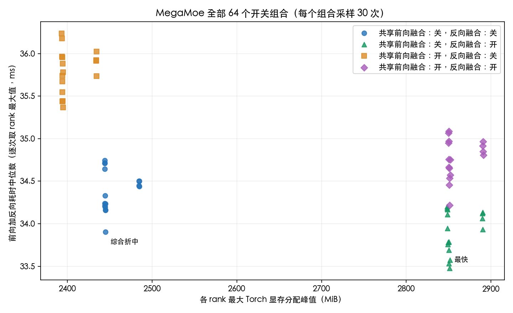
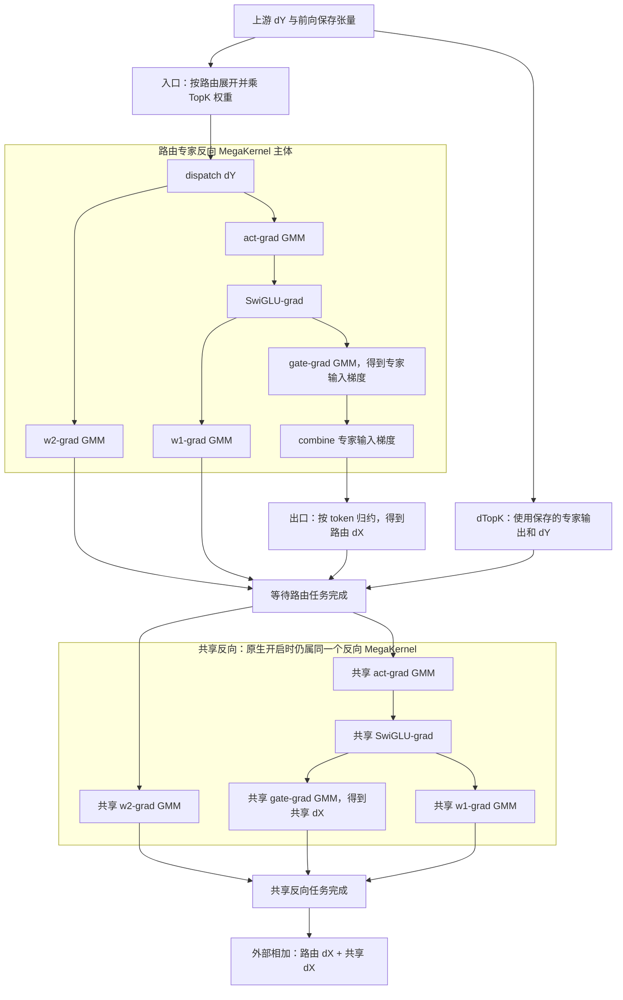

# MegaMoe 全部开关组合性能与显存报告（2026-11-02）

评测口径与算子图说明补充于 2026-11-03；以下数字均沿用 2026-11-02 的实测结果，本次文档补充未重新运行性能测试。

全部 **64 个组合**均完成了 8 次预热和 30 次正式采样。其中 11 个领先组合又交换参考与候选的执行顺序，完成了 **10 次预热和 50 次正式采样**。最快组合为：路由前向和反向均设为 `both`，共享专家前向融合**关闭**、反向融合**开启**。实测综合折中最好的组合为：路由前向和反向均设为 `both`，共享专家前后向融合**均关闭**。没有一个组合同时取得最低耗时、最低 Torch 显存分配峰值和最低 HBM 采样值。

本报告替代 2026-10-31 的对比结论。此前基准会隐式为 MegaMoe 添加共享专家，而 `common` 基线不包含共享专家；共享专家参考路径还会继承候选的路由融合模式。因此，旧报告中的比值不能证明相同工作量下融合特性带来的增量收益。现已修正基准：纯路由测试默认将共享专家中间维度设为零，根据配置的共享专家维度选择参考路径，并显式关闭参考路径的全部融合开关。性能断言失败前会先保存 JSON 证据；矩阵脚本仅放宽性能阈值，以便保留较慢组合的测量结果。

## 固定形状下的配置建议

耗时降幅为正表示候选更快。显存差值为“候选减去同轮参考”，负值表示候选显存更低。`fX_bY_sfA_sbB` 分别表示路由前向模式 X、路由反向模式 Y、共享专家前向融合开关 A 和反向融合开关 B。`legacy` 表示不融合路由端点，`permute` 和 `unpermute` 表示仅融合对应端点，`both` 表示两个端点均融合。下表耗时单位为 ms，显存单位为 MiB（2**20 字节）；“交换顺序复测”仅指候选先运行、参考后运行。

| 目标 | 配置 | 矩阵中位数（30 次） | 交换顺序复测中位数（50 次） | 复测耗时降幅 | 复测 Torch 分配峰值（与参考差值） | 复测 HBM 采样差值 |
| --- | --- | ---: | ---: | ---: | ---: | ---: |
| 最快 | `fboth_bboth_sf0_sb1` | 33.479 | 33.411 | +3.70% | 2848.9 (+404.7) | +42.2 |
| 综合折中 | `fboth_bboth_sf0_sb0` | 33.905 | 34.031 | +1.67% | 2443.5 (-0.7) | -322.8 |
| 较低 HBM | `fpermute_bboth_sf1_sb0` | 35.444 | 35.640 | -2.39% | 2393.0 (-51.3) | -345.2 |
| 最低分配峰值 | `flegacy_blegacy_sf1_sb0` | 36.236 | 36.146 | -4.38% | 2391.9 (-52.3) | +1.8 |

对于本次固定形状基准，建议显式使用以下综合折中配置：

```python
forward_fusion_mode="both"
backward_fusion_mode="both"
forward_shared_expert=False
backward_shared_expert=False
```

共享专家中间维度仍为 1792：关闭融合后，共享专家仍由外部算子执行。如果优先追求训练速度，可以改为 `backward_shared_expert=True`。分配峰值最低的组合（路由 `legacy/legacy`，仅融合共享前向）节省约 50 MiB，但耗时增加超过 4%。HBM 采样值较低的一组配置为：路由前向采用 `permute` 或 `both`，反向采用 `permute` 或 `both`，共享前向融合开启、反向融合关闭。多个领先组合之间仅相差约 2 MiB，无法稳定复现唯一的 HBM 最优组合。完整矩阵中的最低 HBM 采样值来自 `permute/both/1/0`，交换顺序复测中的最低值来自 `both/permute/1/0`。

组件全局默认值仍为路由 `legacy/legacy`、共享融合前后向均关闭。本报告推荐的是固定形状下的显式配置，尚未自动推广到所有形状、通信模式和动态 token 场景。当前全局默认值还需兼容不支持路由融合的动态 token 场景。应先修复并复测下述整合问题，再考虑调整更大范围的默认值。



## 对比口径与适用范围

### 评测对象与收益分母

本次主矩阵测量的是**单层 MoE 专家部分的一次完整前向加反向**。输入是已经生成的 token、TopK 专家编号、TopK 权重、专家 token 计数和上游梯度。以 `p[t,k]` 表示路由权重，前向语义为：

```text
routed[t] = sum_k p[t,k] * Expert[topk_ids[t,k]](x[t])
shared[t] = Linear_down(SiLU(gate[t]) * up[t])
[gate, up] = Linear_gate_up(x)
y[t] = routed[t] + shared[t]
```

前后向都包含共享专家，关闭融合开关不会跳过共享专家。反向计算 dX、dTopK、路由专家 dW1/dW2 和共享专家 dW1/dW2；共享专家对 dX 的贡献需要与路由分支相加。未运行 Router 的投影、评分和 TopK 选择，也未运行辅助损失、优化器、DP 梯度同步或其他模型层。

| 对比层次 | 参考路径 | 候选路径 | 能回答的问题 |
| --- | --- | --- | --- |
| 本报告的 64 组合主矩阵 | `mega_moe_external_shared`：已有 MegaMoe，路由 `legacy/legacy`，外部 Torch 共享专家 | `mega_moe`：同样的路由与共享专家工作量，按四项开关选择融合边界 | 新增路由端点及共享融合，在已有 MegaMoe 上能带来多少增量收益 |
| 独立的纯路由对照 | `common`：`GroupedExperts + ExpertParallel`，不含共享专家 | 既有 MegaMoe，路由 `legacy/legacy`，不含共享专家 | 既有 MegaMoe 相对 common 的整体收益；测得 62.060 → 31.432 ms |

主矩阵参考不是一串完全未融合的 MoE 算子，也不是切换到另一份旧版二进制：参考与候选使用同一套产物，通过开关选择旧执行路径和新增融合路径。参考已经把 dispatch、专家 GMM、SwiGLU、combine 放在既有前后向 MegaKernel 中。**1.67% 或 3.70% 的分母是约 34.6 ms 的“已有 MegaMoe 加外部共享专家”，不能用约 62 ms 的纯路由 common 作为分母。**

两条路径复用相同输入、路由和上游梯度，形状、精度及通信模式一致；专家权重分别独立初始化，没有逐值对齐。独立数值回归使用相同权重对照。性能结果用于比较执行成本，不能代替数值正确性证明。

### 固定配置与实际张量规模

| 项目 | 本次取值 |
| --- | --- |
| 设备与并行 | Ascend 910B3，本机设备 0–3；world size=4，EP=4，TP=1；每 rank 8 个路由专家 |
| 核配置 | 每 rank 20 个 Cube、40 个 Vector worker |
| 软件 | CANN 9.1.0 beta.3；Python 3.11.15；Torch 2.7.1+cpu，配合 torch_npu 2.7.1.post4 |
| 输入与路由 | `x, grad_output: [4096,5120] BF16`；`topk_ids: [4096,8] INT32`；`topk_weights: [4096,8] FP32` |
| 专家形状 | H=5120，路由 I=1792，共享 I=1792，全球路由专家数 E=32，K=8；本地共享 SwiGLU 不参与 EP 分发 |
| 权重布局 | 默认 EIO；本地路由 W1 为 `[8,5120,3584]`、W2 为 `[8,1792,5120]`；共享 W1 为 `[3584,5120]`、W2 为 `[5120,1792]`，均为 BF16 |
| 通信与容量 | push，经 SHMEM 执行 EP 分发和回收；静态 token，初始接收容量系数 1.5，即预留 49152 行；均衡路由下实际接收 32768 行 |
| 切分 | dispatch、combine、SwiGLU 均为 128；融合前向 unpermute 为 16、反向输入归约为 8、TopK 梯度为 32；其余 GMM tiling 沿用现有构建逻辑 |
| 梯度与迭代 | 输入、路由权重及专家权重参与求导；每次 `zero_grad(set_to_none=True)`，不跨步累积；不执行 `optimizer.step()` |
| 样本 | 全部 64 组合：每条路径先做 1 次有效性检查，再预热 8 次、采样 30 次；11 个领先组合交换顺序后预热 10 次、采样 50 次 |

路由由基准直接构造：`topk_ids[t,k] = (8*t + k + 8*rank) % 32`，权重为 `[8,7,6,5,4,3,2,1]/36`，每个 token 相同。每个源 rank 发往每个全球专家 1024 行，每个本地专家从 4 个 rank 接收 4096 行；每 rank 总路由行数为 `4096*8=32768`。基准显式提供精确的 `tokens_per_expert`，因此不计从 TopK 编号重新构建直方图的成本；运行时仍执行路由计数交换和容量、偏移准备。输入与上游梯度的随机种子为 `30000 + rank`。

本次实际使用的构造配置如下；主矩阵仅改变末尾四项开关，参考路径固定为 `legacy/legacy/False/False`：

```python
MegaMoeExperts(
    local_num_tokens=4096,
    hidden_size=5120,
    intermediate_size=1792,
    num_experts=32,
    top_k=8,
    ep_size=4,
    ep_group=dist.group.WORLD,
    dispatch_mode="push",
    initial_capacity_factor=1.5,
    expert_weight_layout="EIO",
    shared_intermediate_size=1792,
    forward_fusion_mode=forward_mode,
    backward_fusion_mode=backward_mode,
    forward_shared_expert=shared_forward,
    backward_shared_expert=shared_backward,
).to(device=DEVICE, dtype=torch.bfloat16)
```

### 前向算子图与融合边界

以下图按**逻辑依赖和 MegaKernel 启动边界**绘制。MegaKernel 内的箭头表示生产者与消费者依赖，现有路由阶段仍按 tile 流水调度，不表示必须等整层上一阶段结束后才执行下一阶段。图不代表 profiler 记录，也不能用于计算已实现的重叠比例。


参考图中的共享专家使用同一条执行流，在路由输出恢复后调用。候选图中的共享分支也被显式依赖排在路由分支之后，当前两者都没有路由与共享专家的并发。融合前向 permute 省去完整 `[T*K,H]` 数据展开，但仍在 kernel 外对标量 route-slot 元数据调用 `npu_moe_token_permute`。共享输出相加仍在 MegaKernel 外执行。

### 反向算子图与开关含义

两条路径的专家反向数学相同：输入梯度经分发、专家梯度计算、回收与归约返回；路由权重梯度依赖前向保存的专家输出。共享反向还需要计算共享 dX、dW1 和 dW2。下图的路由主体由各模式共同保留，入口和出口由开关决定归属；共享后置依赖按反向 `both`、共享反向融合开启绘制。



图中的入口、出口及 dTopK 节点表示数学工作，具体放置如下。原生共享反向开启时，共享阶段在路由图内任务完成后追加到**同一个反向 MegaKernel**；关闭时由外部 Torch/autograd 执行。若 token 梯度归约在 kernel 外，它在 kernel 返回后执行，不能套用图中的归约先于共享关系。全关闭参考由 autograd 决定外部共享与路由梯度分支的遍历顺序，不能据此图推断参考路径的实际遍历顺序。反向 `permute` 的 dTopK 任务在当前融合图中也排在 combine 完成之后。

| 路由模式 | 前向实际路径 | 反向实际路径 |
| --- | --- | --- |
| `legacy` | 外部展开/permute → 原有路由 MegaKernel → 外部加权 unpermute | 外部加权展开并计算 dTopK → 原有反向 MegaKernel → 外部 token 梯度归约 |
| `permute` | 标量索引准备 → dispatch 内按索引读取原始 token → 原有专家计算和 combine → 外部加权 unpermute；图内增加输出可见性确认 | 在 dispatch 内完成 dY 的索引读取和加权，图内计算 dTopK；最终 token 梯度归约仍在外部 |
| `unpermute` | 外部 permute；加权输出恢复移入前向 MegaKernel 尾部 | 入口的加权展开和 dTopK 仍在外部；最终 token 梯度归约移入反向 MegaKernel 尾部 |
| `both` | permute 数据展开并入 dispatch，输出加权 unpermute 并入图内 | dY 索引读取和加权、dTopK 及最终 token 梯度归约均在图内 |

这里的反向 `permute` 按**反向执行顺序**命名：它对应 dY 的展开和加权，属于前向加权 unpermute 的求导。反向 `unpermute` 对应返回 dX 时的归约，属于前向 permute 的求导。它们不是要求前后向同名开关一起开启；四项开关完全独立，共有 `4*4*2*2=64` 个组合。

| 共享前向融合 | 共享反向融合 | 当前实现实际执行内容 |
| --- | --- | --- |
| 关 | 关 | 正常外部共享前向及其 autograd 反向，保留原有计算图 |
| 开 | 关 | 原生共享前向；反向时先重新计算共享前向，再调用外部 autograd 求梯度 |
| 关 | 开 | 在路由前向 MegaKernel 启动前，由 Torch 计算共享前向并拷贝到共享缓存；原生共享反向追加在路由反向任务之后 |
| 开 | 开 | 原生共享前向和反向均追加到相应路由图末尾；输出相加和 dX 相加仍由外部执行 |

因此，共享开关切换的不仅是启动位置，还会改变前向缓存、反向重算、拷贝和布局转换。判断融合收益时必须把这些伴随成本一起计算。

### 计时边界、样本与收益公式

计时实现位于 [`_timed_fwd_bwd`](../../../../tests/torch/multicore/_test_mega_moe.py)。每次迭代的边界为：

```text
计时前：zero_grad；detach 并设置输入/路由权重 requires_grad；dist.barrier；NPU synchronize；创建 Event
主机计时开始 → 记录起始 Event → 完整 layer.forward → output.backward(grad_output)
             → 记录结束 Event → NPU synchronize → 主机计时结束
计时后：检查梯度；耗时在 rank 间取 MAX；同步采样显存
```

| 包含在耗时内 | 不包含在耗时内 |
| --- | --- |
| Python/autograd 调用、实际路由准备、计数交换及其等待、容量与元数据处理、forward 内的分配/拷贝、完整路由通信与专家计算、共享分支、输出和梯度相加、结束同步等待 | 设备与进程组初始化、层构造与参数初始化、输入/路由生成、清零梯度、迭代前 barrier、耗时 MAX 归约、数值检查和显存查询、GC/empty_cache、优化器与其他模型层 |

计划及 SHMEM 的首次初始化发生在正式样本之前的检查/预热阶段。稳态运行中每次 forward 仍执行的元数据处理、同步和分配成本保留在计时内。Event 计时在设备流上覆盖上述 forward/backward 区间，可能包含设备等待主机继续下发的空隙；主机计时还包含 Event 记录和最终同步的主机开销。两者都不是仅对两个 custom kernel 执行时间求和。

对任一路径，令 `h[r,i]` 为第 r 个 rank 的第 i 次主机耗时，则：

```text
逐次样本 L[i] = max_r h[r,i]
报告耗时 T = median_i L[i]
耗时降幅 = (1 - T_candidate / T_reference) * 100%
加速比 = T_reference / T_candidate
```

均值、最小值、最大值同样针对 `L[i]` 计算；Event 数据单独按同样方式聚合，不与主机耗时相加。该口径是“逐次取 rank 最大值，再求中位数”，不同于“每个 rank 先求中位数，再取最大值”。主表使用**耗时降幅**而非加速比：例如 34.694 → 33.411 ms 表示降幅 3.70%，加速比约 1.038 倍。

完整矩阵先运行参考、后运行候选；每条路径独立检查、预热和采样。11 个领先组合交换执行顺序，候选先运行、参考后运行。每个组合新建分布式进程组，同一组合的两条路径在相同进程组内依次运行；两者之间执行 GC、`empty_cache` 和 barrier。它们不是每一条路径各自独占一个全新进程，分配器和运行时状态可能受执行顺序影响。全关闭对照的耗时差异小于 0.2%，但不能据此建立所有配置的统计置信区间，也不能将不同轮次的耗时差相加，解释为各阶段独立贡献。

### 显存边界与结论限制

显存是完整设备占用/分配的绝对值，不是扣除输入、权重等固定成本后的净工作区。每条路径构造完成后、首次检查和预热前重置 Torch 峰值统计；因此，allocator 峰值覆盖首次检查、预热及正式采样，而耗时只统计正式样本。构造完成时仍存活的输入、权重等也计入当前分配基数。

| 指标 | 测量方式与 rank 聚合 | 可以说明的收益 |
| --- | --- | --- |
| Torch allocated 峰值 | `max_memory_allocated`，再取 rank 最大值 | allocator 跟踪的存活分配峰值；不包含 SHMEM 等 allocator 外占用 |
| Torch reserved 峰值 | `max_memory_reserved`，再取 rank 最大值 | Torch 缓存池预留峰值，受分配顺序和碎片影响，不等于存活张量峰值 |
| HBM 采样最大值 | 每次检查/预热/正式迭代同步后取 `total-free`，先取时间最大值，再取 rank 最大值 | 采样时刻的设备占用，包括缓存池、SHMEM 和驱动可见分配；会漏掉迭代内部瞬时峰值 |
| SHMEM | 读取配置的 heap bytes，并取最大值 | 所有路径均为 840,957,952 字节（802.0 MiB），本轮没有减少对称堆容量 |

HBM 采样值**不是连续物理峰值，也不是仅归属当前算子的净显存**。本次未采集 rank 求和或集群总显存；单层前后向也不代表深层模型同时保留多层激活时的峰值。关闭共享反向融合时，`both/both` 的交换顺序复测 HBM 采样值下降约 323 MiB，而 Torch allocated 峰值基本持平，这只能确认采样时刻占用/预留降低，不能解释为峰值存活张量减少 323 MiB。共享反向增加约 405 MiB 的 allocated 峰值；首次扫描中的 HBM 收益在交换顺序后消失。

本次耗时测量没有 profiler 插桩，也没有逐阶段设备 active/wait 数据。只能对现有固定形状的完整前后向及显存作结论，不外推到 910C、pull、偏斜或动态路由、深层模型吞吐及优化器步骤。

## 性能收益为什么不明显

### 数据能确认的增量收益有多大

下表全部使用**该组合本轮的配对参考**。正的“节省时间”表示更快；前五项为 30 次矩阵样本，后三项为 50 次交换顺序复测。它们用于观察方向，不能将各行节省时间相加来重构组合收益。

| 候选变化（其余开关关闭） | 采样次数 | 参考 → 候选（ms） | 节省时间（ms） | 耗时降幅 |
| --- | ---: | ---: | ---: | ---: |
| 仅路由前向 `permute` | 30 | 34.699 → 34.745 | -0.046 | -0.13% |
| 仅路由前向 `unpermute` | 30 | 34.788 → 34.716 | +0.072 | +0.21% |
| 仅路由反向 `permute` | 30 | 34.731 → 34.239 | +0.492 | +1.42% |
| 仅路由反向 `unpermute` | 30 | 34.740 → 34.503 | +0.236 | +0.68% |
| 仅共享前向融合 | 30 | 34.697 → 36.236 | -1.539 | -4.44% |
| 路由前后向 `both`，共享融合关闭 | 50 | 34.608 → 34.031 | +0.577 | +1.67% |
| 路由前后向 `both`，仅共享反向融合 | 50 | 34.694 → 33.411 | +1.282 | +3.70% |
| 路由前后向 `both`，仅共享前向融合 | 50 | 34.638 → 35.439 | -0.801 | -2.31% |

前向端点单开在本次 30 样本扫描中仅体现约 -0.046 至 +0.072 ms 的变化，缺少独立重复和置信区间，不能认定为稳定收益。反向端点和组合融合能降低完整前后向耗时，但实测增量仍在亚毫秒到约 1.3 ms 的范围。

### 从算子图解释收益受到哪些限制

**第一，参考已经实现了主体融合，本次改变的是端点与共享分支的执行方式。** 路由分发、两次前向 GMM、激活、回收及反向主体都已在 MegaKernel 内。新增融合没有减少专家矩阵乘的算术量，也没有减少逻辑 EP 分发和回收的数据量；push 下仍按 8 条专家路由发送数据。本次前向 permute 是“按索引直接读取原始 token 并分发”，并未实现跨专家或跨目标 rank 的通信数据去重。无需再物化一份 320 MiB 的 `[32768,5120] BF16` 展开张量，不代表全链路通信量或峰值显存下降相同比例。

**第二，减少外部启动的同时，图内新增了任务与同步。** 路由排序、计数交换、偏移准备及部分保存/拷贝仍在外部；前向 unpermute 和反向归约只是移动到图内，数学工作和必要读写仍然存在。按工作任务数统计，参考前后向共 `3392+3712=7104` 个任务，路由 `both/both` 共 `3648+4352=8000` 个，增加 896 个（约 12.6%）；最快组合再追加 112 个共享反向任务，共 8112 个。这里的任务数不是 kernel 启动数，也不能直接换算耗时，但它证明启动合并伴随着新的队列调度、事件等待和归约工作，不能预设这些成本为零。

**第三，当前共享融合没有通过重叠缩短关键路径，部分开关还带来额外工作。** 原生共享阶段等待路由分支完成后才执行，前向结果与 dX 的相加仍在外部。仅共享前向融合在反向阶段重新计算共享前向；仅共享反向融合则伴随外部共享结果拷贝、梯度布局转换。最直接的实测信号是：仅共享前向融合从约 34.697 ms 退化到 36.236 ms。代码能确认重复计算存在，但本次未单独测量其耗时，不能将 1.539 ms 全部归因给某一次矩阵乘或拷贝。

**第四，缓冲区复用问题增加了共享反向融合的显存成本。** 下节给出了误禁用复用的 host 校验证据，额外 `gate_dx` 为 320 MiB。它解释了约 405 MiB 分配峰值增加中的主要部分；对其产生的额外访存、分配开销及具体耗时影响，仍需修复前后配对测量，不能仅根据显存字节数推算速度收益。

按形状估算，每 rank 路由前向三个矩阵乘的总计算量为 `6*T*K*H*I≈1.804 TFLOP`，共享前向为 `6*T*H*I_shared≈0.225 TFLOP`；这里将 gate/up 合并投影计为两个矩阵乘，单次乘加计 2 FLOP，忽略激活。由于 I 与 I_shared 相同，共享分支约占两者前向矩阵乘计算量的 1/9。这只是静态算术量比例，**不是实测耗时占比**，不能据此断言算力受限、带宽受限或通信占主导，也不能把 11.1% 当作本次加速上限。

若被优化部分占参考关键路径耗时比例为 `p`，其加速倍数为 `s`，且不引入新成本，则完整路径加速比为 `1/((1-p)+p/s)`。本轮没有测出 `p` 和阶段间重叠，因此只能用这一关系解释“局部优化不等于整层同比例加速”，不能据此预测修复后的具体百分比。

### 已证实的原因与后续验证范围

| 判断 | 当前证据 | 结论边界或下一步 |
| --- | --- | --- |
| 收益分母是已融合主体；通信和 GMM 数学工作仍保留 | 前后向算子图、固定配置与全关闭参考定义 | 能解释本次是增量优化；不能证明各阶段占比 |
| 共享串行依赖、前向重算、额外拷贝/转置确实存在 | `shared_schedule.py`、`fusion.py` 的执行分支 | 运行结构已确认；各项耗时需独立 trace 或修复消融 |
| 共享反向误禁用复用，新增 320 MiB buffer | 64 配置 host 调度检查及 allocated 峰值变化 | 复用恢复后需数值、保留计算图和性能回归，才可量化收益 |
| 单个前向端点的微小差异可能受波动影响 | 单轮变化约 -0.13% 至 +0.21%，缺少重复统计 | 不将其作为明确的性能提升；需要更多独立轮次 |
| 主要瓶颈属于 GMM、通信、AIV 等待还是主机同步 | 尚无逐阶段 active/wait、通信带宽或主机时间线证据 | 当前无法下定论；用少量独立 profiler 样本定位启动/拷贝，用内部计数器量化任务执行与等待，正式耗时继续使用无插桩产物 |

复现与审查入口：[`_test_mega_moe.py`](../../../../tests/torch/multicore/_test_mega_moe.py) 定义数据、计时和参考选择；[`run_mega_moe_switch_matrix.sh`](../../../../tests/torch/multicore/run_mega_moe_switch_matrix.sh) 定义 64 组合；[`module.py`](../modules/mega_moe/module.py)、[`fusion.py`](../modules/mega_moe/fusion.py) 定义外部/融合执行分支；[`forward/graph.py`](../modules/mega_moe/forward/graph.py)、[`backward/graph.py`](../modules/mega_moe/backward/graph.py) 和 [`shared_schedule.py`](../modules/mega_moe/shared_schedule.py) 定义图与依赖。下节进一步说明可修复的整合问题和验证要求。

## 限制性能收益的整合问题

1. **共享反向融合误禁用了既有的路由缓冲区复用。** `backward/storage.py::_expert_events_join_readers` 将全部 `TASK_SWI_GLU_GRAD` 都作为路由专家任务收集。共享 SwiGLU-grad 使用间接指针槽位 36，其 32 个任务因此被错误计入按路由专家组织的事件校验。对全部 64 个配置的 host 审查显示：共享反向融合关闭时，复用判定均为 true；开启时均为 false。对一个开启共享反向的案例，worker 读取顺序校验通过、事件校验失败；仅排除共享 SwiGLU 任务后，事件校验即通过。因此，融合路径会额外分配 `[32768,5120] BF16` 的 `gate_dx`，占用 **320 MiB**，而无法复用接收到的 dY 缓冲区。这解释了约 405 MiB 分配增量中的大部分。建议的最小修复是：先匹配路由 SwiGLU 的输入输出 ABI 槽位，再将对应任务纳入复用证明，同时保留现有读取者和事件安全检查。修复后需补充 host 拒绝非法情况的测试、共享与路由交叉数值回归、保留计算图后重复反向的验证，并重新测量显存和性能矩阵。本轮未修改运行时复用逻辑。

2. **仅融合共享前向时，反向会重复计算共享前向。** 原生共享反向关闭时，`fusion.py::_finish_backward` 会在 autograd 中重新构建两次线性投影和 SwiGLU。前向中间结果已经保存，但没有被用于直接计算外部梯度。相比之下，全关闭的外部分支直接使用原有 autograd 图。这次额外前向计算是仅融合共享前向的组合慢约 2–4% 的一个明确实现成本。建议让外部反向直接使用已保存的 gate/up 和激活张量，或采用保留外部计算图的独立 autograd 组合方式。

3. **共享任务串行排在路由分支之后。** `shared_schedule.py::add_shared_graph` 将每个路由终止节点连接到第一个共享 GMM；反向的共享 act-grad 和 w2-grad 也等待路由分支完成。当前整合减少了启动边界，但没有实现路由与共享分支的重叠。要实现重叠，需要单独审查任务与事件调度、证明缓冲区归属及生命周期安全，并采集 trace 或计数器证据，不能仅删除依赖边。

4. **共享回退路径增加了拷贝和布局转换。** 共享前向融合关闭、反向融合开启时，`_prepare_forward_buffers` 先由外部 Torch 算子计算结果，再将结果拷贝到另行分配的 `shared_up_proj`、`shared_activation` 和 `shared_output`。原生反向生成转置布局的 dW 缓冲区后，还要对两份权重梯度执行 `.t().contiguous()`。每次前向和反向也会创建并上传锁页主机内存中的指针表。这些都会增加内存流量和启动、准备成本。建议先在生命周期允许时直接复用外部结果，并调整原生梯度输出布局，再推进更复杂的调度优化。

5. **路由融合仍保留必要工作，并增加了队列任务。** 融合前向 permute 后，标量槽位元数据仍需调用 `npu_moe_token_permute`；省去的是 `[T*K,H]` 数据展开，路由排序仍需执行。通信和 grouped matmul 没有变化。前向 unpermute 增加 256 个 Vector 任务；反向 `both` 增加 128 个 top-k 梯度任务和 512 个输入梯度归约任务。共享分支也仍保留独立中间张量和最终输出相加。因此，融合并不等于消除了这些阶段的 HBM 流量。

6. **原有测量缺陷影响了基线收益的解释。** 本轮修正了参考路径选择、隐式共享专家维度、参考继承候选路由模式，以及性能失败分支引用未定义变量的问题。交换执行顺序的全关闭对照显示：即使执行语义相同，Torch 缓存池预留和 HBM 占用也可能相差超过 100 MiB。因此，本报告分别列出实际分配峰值、缓存池预留和设备占用采样值，不再依据旧报告中相对 `common` 的耗时降幅选择融合默认值。

建议的优先顺序为：① 在保留安全条件的前提下恢复路由缓冲区复用；② 消除共享专家部分融合时的前向重算和额外拷贝；③ 再开展重叠调度实验。前两项针对的是已定位的整合成本，无需新增设备数学 kernel。本报告的矩阵反映上述运行时修复实施前的当前版本。

## 调度任务数证据

下表列出每个 rank 的计算图工作任务数。CSV 中的队列计数包含控制和终止条目，可能与序列化字段 `task_num` 相差 1。全部 64 个组合的完整阶段任务数保存在 JSON 的 `schedule_audit` 中。

| 分支或配置 | 每个 rank 的阶段任务数 |
| --- | --- |
| 路由前向基础任务 | 分发（dispatch）1024，上投影 GMM 160，SwiGLU 1024，下投影 GMM 160，回收（combine）1024 |
| 路由反向基础任务 | 分发 1024，激活梯度 160，w2 梯度 160，SwiGLU 梯度 1024，输入投影梯度（gate-grad）160，回收 1024，w1 梯度 160 |
| 前向 `both` 新增任务 | 加权 unpermute 256 |
| 前向 `permute`、外部恢复输出 | 输出可见性确认（output acquire）20 |
| 反向 `both` 新增任务 | top-k 权重梯度 128，输入 unpermute 梯度 512 |
| 共享前向新增任务 | 上投影 GMM 20，SwiGLU 32，下投影 GMM 20 |
| 共享反向新增任务 | 激活梯度 20，w2 梯度 20，SwiGLU 梯度 32，输入投影梯度（gate-grad）20，w1 梯度 20 |

## 正确性验证与版本信息

- **Host 回归：** 110 项测试、623 个子测试通过，产生 5 条警告。覆盖 MegaMoe、L1 张量转储、诊断功能、诊断调用及 Torch 算子。
- **修正后的纯路由性能对照：** 共享专家中间维度为零，8 次预热和 30 次正式采样；`common` 为 62.060 ms，既有 MegaMoe 为 31.432 ms。这验证了移除隐式共享专家计算后、工作量一致的原有基准。该项属于独立对照，不能用于证明本次路由或共享融合的增量收益。
- **交叉开关回归：** 两个 rank 各通过全部 **64/64 个组合**，共 128 条通过记录。以相同权重、全关闭配置为参考，比较输出、dX、dTopK、路由专家 dW1/dW2 和共享专家 dW1/dW2。测试形状为 T128、H5120、路由 I128、共享 I1792、E4、K2、push EP2；BF16 容差为 `rtol=0.05`、`atol=0.01`。性能形状的运行会检查路由梯度存在且为有限值，但未对每个完整尺寸组合进行数值对照。此前路由回归还覆盖了随机路由、接收端为空的 pull 路由及保留计算图后重复反向。
- **测量时的本地实现：** `590fdf07c358c3eae11c7a52ba63f65029f3380c`，基于上游 `e0cdf62c`。本报告对应的基准修正没有修改设备代码。远端 worktree 为 `/home/yjk/workspace/hyper-parallel-megamoe-20261029`，隔离环境为 `/home/yjk/.conda/envs/hp-megamoe-cann91`。远端 Git HEAD 保持为 `96143af9b4ea12ddf0bd3854fc521ca86df7cc90`，通过同步覆盖源码运行。除两份图文件仅存在注释和文档字符串差异外，MegaMoe 模块源码哈希与本地实现一致。
- **原生产物路径：** `build/native/payload/hyper_parallel/core/multicore/lib/vendors/hyper_parallel_multicore_nn`；使用 `bash hyper_parallel/core/multicore/build.sh --soc-list ascend910b --jobs 8` 从源码构建 ascend910b 产物。本次测量更新未使用或修改预编译归档。
- **前向目标文件哈希：** `HyperMegaMoe_7e1f97a19c0d73f2e1a41585321824cb.o` = `b969e9d13929dd5797fe20dfa4e6939dec19e0eb8052a9a53bf8c3232fedad75`；`HyperMegaMoe_36b675f6e4e521b7bb1c18cf58839a74.o` = `2fffe109bd8cf233024fef467dc5c6d6a7f40420073f8be7a7c6f1b7350a41c3`。
- **反向目标文件哈希：** `HyperMegaMoeGrad_427d7efcfe6f35058c9a50ee97ae10cb.o` = `3cda93dd3f4fa7a68b68c11cf53bdff96b8254b2c044808c17cfc11a45c55045`；`HyperMegaMoeGrad_52b89ce802c59f45be5946dda710678d.o` = `ac11dc1151be779d1acc96787ad3c23b24b2f1174b97376f81ce94faf9dcd6b7`。
- **远端原始证据：** `/tmp/hp-switch-matrix-formal-20261102`、`/tmp/hp-switch-finalists-reverse-20261102`、`/tmp/hp-switch-matrix-correctness-20261102.log`、`/tmp/hp-matrix-host-tests-20261102.log`。初始 8 次采样的预检查结果未纳入本报告任何表格或排名。

激活隔离的 CANN/Torch 环境和对应原生产物后，在仓库根目录执行以下命令即可复现：

```bash
bash tests/torch/multicore/run_mega_moe_switch_matrix.sh /tmp/hp-mega-moe-switch-matrix
HP_MEGA_MOE_PERF_REVERSE=1 bash tests/torch/multicore/run_mega_moe_switch_matrix.sh /tmp/hp-mega-moe-switch-matrix-reverse
```

第一条命令先运行参考、后运行候选；第二条命令交换两者的执行顺序。脚本按顺序执行，支持断点续跑：跳过已有结果 JSON 的组合，记录返回码并保留失败信息。需要重跑时请使用新的输出目录。共享与路由交叉正确性测试 worker 需设置 `HP_MEGA_MOE_TEST_ROUTE_MATRIX=1`。

上述矩阵脚本的两种执行顺序均固定为 8 次预热、30 次采样。复现主表的 50 次复测口径时，应直接设置测试入口；例如最快组合为：

```bash
env HP_MEGA_MOE_PERF_REVERSE=1 \
  HP_MEGA_MOE_PERF_WARMUP=10 HP_MEGA_MOE_PERF_MEASURED=50 \
  HP_MEGA_MOE_MAX_PERF_RATIO=100 \
  HP_MEGA_MOE_EVIDENCE_DIR=/tmp/hp-mega-moe-fastest-reverse-50 \
  HP_MEGA_MOE_SHARED_INTERMEDIATE_SIZE=1792 \
  HP_MEGA_MOE_FORWARD_SHARED_EXPERT=0 HP_MEGA_MOE_BACKWARD_SHARED_EXPERT=1 \
  HYPER_PARALLEL_MEGA_MOE_FORWARD_FUSION_MODE=both \
  HYPER_PARALLEL_MEGA_MOE_BACKWARD_FUSION_MODE=both \
  pytest -q tests/torch/multicore/test_mega_moe.py -k representative_performance --disable-warnings --tb=short
```

其余 10 个复测组合名称见 JSON 的 `reverse_finalists` 键；改变四项开关即可使用同一口径复测。综合折中组合对应 `both/both/0/0`。

## 全部 64 个组合明细

每行均包含 30 次正式采样。耗时降幅相对该行同轮运行的全关闭参考计算。共享开关为 0 表示由外部算子执行，共享专家仍参与计算。Torch 分配峰值和 HBM 采样值单位为 MiB。[CSV 明细](benchmarks/mega_moe_switch_matrix_20261102.csv) 包含全部 75 轮 A/B 对比的精确字节数、参考值、主机及 Event 耗时的均值和极值，以及任务数；[JSON 原始数据](benchmarks/mega_moe_switch_matrix_20261102.json) 保留全部样本、调度审查和正确性证据。

| 路由前向 | 路由反向 | 共享前向融合 | 共享反向融合 | 耗时中位数（ms） | 耗时降幅 | Torch 分配峰值（MiB） | HBM 采样值（MiB） |
| --- | --- | ---: | ---: | ---: | ---: | ---: | ---: |
| both | both | 0 | 0 | 33.905 | +2.18% | 2445.0 | 4261.0 |
| both | both | 0 | 1 | 33.479 | +4.30% | 2850.9 | 4628.7 |
| both | both | 1 | 0 | 35.365 | -1.86% | 2394.7 | 4217.6 |
| both | both | 1 | 1 | 34.218 | +1.44% | 2851.1 | 4619.5 |
| both | legacy | 0 | 0 | 34.644 | +0.19% | 2444.3 | 4608.5 |
| both | legacy | 0 | 1 | 34.108 | +1.84% | 2848.7 | 4922.2 |
| both | legacy | 1 | 0 | 35.956 | -3.66% | 2394.0 | 4566.4 |
| both | legacy | 1 | 1 | 34.968 | -0.72% | 2850.4 | 4924.1 |
| both | permute | 0 | 0 | 34.198 | +1.54% | 2444.4 | 4260.7 |
| both | permute | 0 | 1 | 33.534 | +3.50% | 2850.4 | 4628.4 |
| both | permute | 1 | 0 | 35.438 | -2.07% | 2394.1 | 4218.3 |
| both | permute | 1 | 1 | 34.458 | +0.99% | 2850.6 | 4618.2 |
| both | unpermute | 0 | 0 | 34.438 | +0.73% | 2484.8 | 4650.4 |
| both | unpermute | 0 | 1 | 33.935 | +2.27% | 2890.3 | 4958.3 |
| both | unpermute | 1 | 0 | 35.733 | -2.76% | 2434.6 | 4566.3 |
| both | unpermute | 1 | 1 | 34.807 | -0.21% | 2891.0 | 4923.8 |
| legacy | both | 0 | 0 | 34.163 | +1.59% | 2444.8 | 4570.7 |
| legacy | both | 0 | 1 | 33.690 | +2.81% | 2850.2 | 4904.7 |
| legacy | both | 1 | 0 | 35.881 | -3.47% | 2394.5 | 4549.3 |
| legacy | both | 1 | 1 | 34.574 | +0.15% | 2851.8 | 4906.4 |
| legacy | legacy | 0 | 0 | 34.711 | -0.17% | 2444.2 | 4555.3 |
| legacy | legacy | 0 | 1 | 34.179 | +1.51% | 2848.2 | 4905.0 |
| legacy | legacy | 1 | 0 | 36.236 | -4.44% | 2393.4 | 4549.4 |
| legacy | legacy | 1 | 1 | 35.066 | -1.31% | 2849.8 | 4906.3 |
| legacy | permute | 0 | 0 | 34.239 | +1.42% | 2444.3 | 4571.1 |
| legacy | permute | 0 | 1 | 33.947 | +2.17% | 2848.7 | 4904.7 |
| legacy | permute | 1 | 0 | 35.670 | -2.82% | 2393.9 | 4549.2 |
| legacy | permute | 1 | 1 | 34.757 | +0.08% | 2850.4 | 4907.0 |
| legacy | unpermute | 0 | 0 | 34.503 | +0.68% | 2484.3 | 4612.4 |
| legacy | unpermute | 0 | 1 | 34.122 | +1.78% | 2889.7 | 4940.8 |
| legacy | unpermute | 1 | 0 | 35.913 | -3.30% | 2434.0 | 4549.2 |
| legacy | unpermute | 1 | 1 | 34.914 | -0.50% | 2890.4 | 4906.9 |
| permute | both | 0 | 0 | 34.160 | +1.37% | 2444.8 | 4245.2 |
| permute | both | 0 | 1 | 33.574 | +3.26% | 2851.7 | 4610.8 |
| permute | both | 1 | 0 | 35.444 | -1.92% | 2394.5 | 4200.1 |
| permute | both | 1 | 1 | 34.754 | -0.25% | 2851.8 | 4601.0 |
| permute | legacy | 0 | 0 | 34.745 | -0.13% | 2444.1 | 4592.7 |
| permute | legacy | 0 | 1 | 34.166 | +1.40% | 2848.5 | 4904.4 |
| permute | legacy | 1 | 0 | 36.179 | -4.14% | 2393.8 | 4548.8 |
| permute | legacy | 1 | 1 | 35.088 | -1.13% | 2850.2 | 4907.4 |
| permute | permute | 0 | 0 | 34.211 | +1.54% | 2444.3 | 4245.1 |
| permute | permute | 0 | 1 | 33.786 | +2.60% | 2850.2 | 4610.8 |
| permute | permute | 1 | 0 | 35.548 | -2.77% | 2393.9 | 4200.7 |
| permute | permute | 1 | 1 | 34.666 | +0.13% | 2850.4 | 4600.5 |
| permute | unpermute | 0 | 0 | 34.502 | +0.44% | 2484.7 | 4634.9 |
| permute | unpermute | 0 | 1 | 34.135 | +1.61% | 2890.1 | 4939.9 |
| permute | unpermute | 1 | 0 | 36.022 | -3.56% | 2434.3 | 4548.0 |
| permute | unpermute | 1 | 1 | 34.965 | -0.58% | 2890.8 | 4906.6 |
| unpermute | both | 0 | 0 | 34.236 | +1.11% | 2445.0 | 4609.4 |
| unpermute | both | 0 | 1 | 33.785 | +2.63% | 2849.4 | 4922.3 |
| unpermute | both | 1 | 0 | 35.781 | -3.13% | 2394.7 | 4566.9 |
| unpermute | both | 1 | 1 | 34.535 | +0.64% | 2851.1 | 4924.8 |
| unpermute | legacy | 0 | 0 | 34.716 | +0.21% | 2443.9 | 4608.7 |
| unpermute | legacy | 0 | 1 | 34.202 | +1.23% | 2848.3 | 4922.4 |
| unpermute | legacy | 1 | 0 | 35.966 | -4.00% | 2393.6 | 4566.3 |
| unpermute | legacy | 1 | 1 | 34.948 | -0.62% | 2850.0 | 4924.3 |
| unpermute | permute | 0 | 0 | 34.333 | +1.05% | 2444.4 | 4608.9 |
| unpermute | permute | 0 | 1 | 33.759 | +2.71% | 2848.9 | 4922.4 |
| unpermute | permute | 1 | 0 | 35.739 | -3.01% | 2394.1 | 4566.0 |
| unpermute | permute | 1 | 1 | 34.654 | +0.02% | 2850.6 | 4924.7 |
| unpermute | unpermute | 0 | 0 | 34.449 | +0.72% | 2484.5 | 4650.1 |
| unpermute | unpermute | 0 | 1 | 34.061 | +1.93% | 2889.9 | 4958.4 |
| unpermute | unpermute | 1 | 0 | 35.924 | -3.72% | 2434.2 | 4566.3 |
| unpermute | unpermute | 1 | 1 | 34.848 | -0.58% | 2890.6 | 4923.7 |
